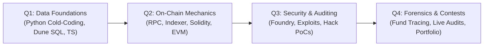

# Blockchain Analyst & Smart Contract Security: From Scratch

[](https://opensource.org/licenses/MIT)
[]()
[]()

> A 365-day technical execution log transitioning from software development foundations into a hand-coding **Blockchain Intelligence Analyst** and **Smart Contract Security Auditor**.

---

## 📌 Repository Overview

This repository holds daily, hand-written technical deliverables spanning blockchain data engineering, EVM internals, static analysis, vulnerability research, and competitive auditing.

* **Engineer**: [deuce01](https://github.com/deuce01)
* **Contact**: [chegev704@gmail.com](mailto:chegev704@gmail.com)
* **Goal**: Build muscle memory, deep syntax fluency, and production-grade on-chain forensics & smart contract exploit verification from scratch.
* **Master Progress Tracker**: [TRACKER.md](./TRACKER.md)
* **Daily Activity Guide**: [DAILY_CURATED_ACTIVITIES_GUIDE.md](./DAILY_CURATED_ACTIVITIES_GUIDE.md)

---

## 🧭 12-Month Technical Roadmap



| Quarter | Focus | Primary Stack | Key Milestone / Deliverable |
|---|---|---|---|
| **Q1 (Months 1–3)** | Cold-Coding Fluency & Data Foundations | Python 3.12+, Mypy, PostgreSQL, Dune SQL, TypeScript | CLI Ledger Analyzer, Public Dune Dashboards |
| **Q2 (Months 4–6)** | On-Chain Mechanics & EVM Internals | Raw JSON-RPC, WebSockets, Solidity, EVM Opcodes | **Milestone 1**: Real-Time Whale & DEX Alert Indexer |
| **Q3 (Months 7–9)** | Smart Contract Security & Exploits | Foundry (`forge`, `cast`), Slither, Ethernaut | **Milestone 2**: 3 Historical DeFi Hack Reproductions & Postmortems |
| **Q4 (Months 10–12)** | Forensics, Audits & Proof-of-Work | Python Graphviz, Sherlock/Cantina, Threat Models | Forensic Intelligence Briefs, Competitive Audit Findings |

---

## 🛠️ The 60-Minute Daily Execution Protocol

Every commit in this repository follows a strict daily 3-phase discipline:
1. **Minutes 00–15 (Pen & Paper Design)**: Draft data structures, algorithm flowcharts, or EVM storage slots in a physical notebook before touching the editor.
2. **Minutes 15–50 (Strict Cold Coding)**: Hand-code logic with zero AI autocompletion. Consult only official language documentation, EVM opcode references, and protocol standards.
3. **Minutes 50–60 (Verification & Git Push)**: Run strict test suites (`mypy --strict`, `pytest`, `forge test -vvvv`), verify outputs, and push a conventional commit.

---

## 📂 Repository Structure

```
blockchain-analyst-from-scratch/
├── docs/
│   ├── architectures/           # Notebook scans & state machine diagrams
│   └── postmortems/             # Written exploit reports & vulnerability analyses
├── q1_foundations/
│   ├── month01_python_cold/     # Days 01–30: Syntax fluency, data structures, capstone
│   ├── month02_async_pipelines/ # Days 31–60: Pydantic v2 schemas, asyncio, pytest
│   └── month03_sql_typescript/  # Days 61–90: Postgres DDL, CTEs, Dune SQL, TypeScript
├── q2_mechanics/
│   ├── month04_rpc_calldata/    # Days 91–120: Raw JSON-RPC, ABI calldata decoding
│   ├── month05_indexer/         # Days 121–150: Milestone 1 Real-time Alert Indexer
│   └── month06_solidity_evm/    # Days 151–180: Hand-coded Solidity & EVM bytecode
├── q3_security/
│   ├── month07_foundry_testing/ # Days 181–210: Foundry unit tests, fuzzing, Slither
│   ├── month08_vulnerabilities/ # Days 211–240: Reentrancy, precision loss, oracle hacks
│   └── month09_historical_hacks/# Days 241–270: Milestone 2 DeFi hack PoCs & writeups
└── q4_proof_of_work/
    ├── month10_forensics/       # Days 271–300: Multi-hop graph tracing & forensic briefs
    ├── month11_audit_contests/  # Days 301–330: Sherlock / Cantina audit contest reviews
    └── month12_portfolio/       # Days 331–365: Flagship showcase & interview drills
```

---

## 📖 Official Reference Whitelist

During study sessions, only sanctioned official references are consulted:
* **Python**: [docs.python.org/3/](https://docs.python.org/3/)
* **EVM Opcodes**: [evm.codes](https://www.evm.codes/)
* **Solidity**: [docs.soliditylang.org](https://docs.soliditylang.org)
* **Foundry Book**: [book.getfoundry.sh](https://book.getfoundry.sh/)
* **EIP Standards**: [eips.ethereum.org](https://eips.ethereum.org/)
* **Dune Docs**: [dune.com/docs](https://dune.com/docs/)
